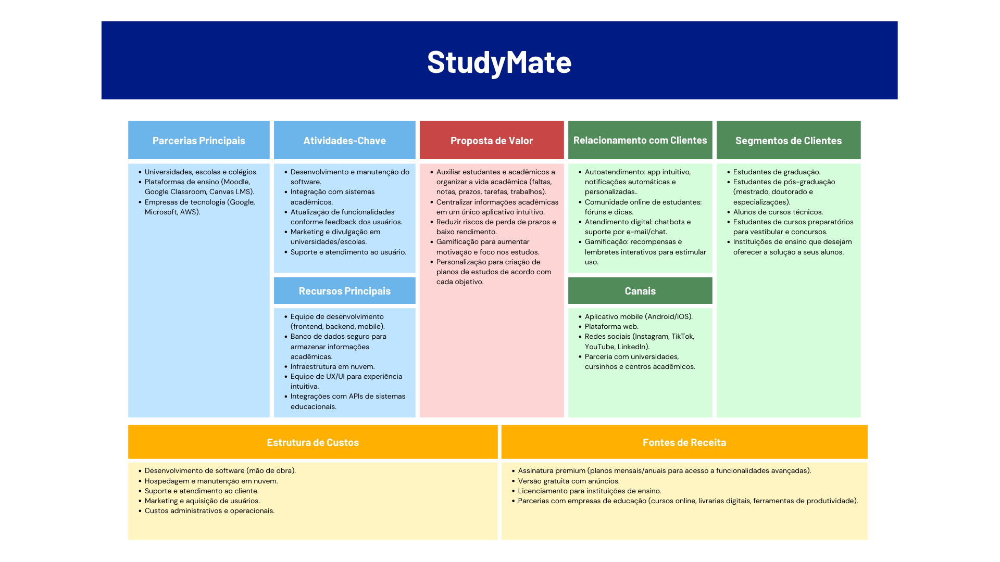

# `StudyMate`

## Testar neste computador (Windows)

Dê dois cliques em `iniciar-studymate.cmd`. Aguarde a preparação da API;
o navegador abrirá em http://localhost:8080/.

- E-mail de teste: `teste@studymate.local`
- Senha de teste: `StudyMate123!`
- Para encerrar: execute `parar-studymate.cmd`.

O modo local usa H2 persistente em `backend/.local/`, sem precisar configurar
Oracle. Os dados permanecem após fechar e reabrir. Para testar novos cadastros,
os e-mails de confirmação ficam em `backend/.local/emails/`: abra o arquivo
mais recente e copie o código para a tela de confirmação. Nenhum e-mail é enviado
pela internet nesse modo. Os logs dos serviços ficam em `.local/` na raiz.

Pré-requisitos para outro computador: JDK 17 ou superior, Node.js 20 ou superior
com npm e internet na primeira execução. O iniciador detecta JDKs em JAVA_HOME,
Eclipse Adoptium, Java e `.jdks`. O Maven Wrapper baixa as dependências.
As portas locais 8080 e 8081 precisam estar disponíveis.

Este ambiente ativa explicitamente o perfil `local`, com conta de demonstração
e caixa de e-mail em arquivos. Use apenas para testes no próprio computador.
A configuração padrão da API continua destinada ao Oracle e SMTP.

Para testar o aplicativo nativo, execute `iniciar-mobile.cmd` e siga o
[tutorial para o celular](mobile/TESTE-NO-CELULAR.md). O iniciador configura a API
na rede local e o Expo na porta 8082. O mobile requer Node.js 22.13 ou superior.
O mobile usa SDK 57, correspondente ao Expo Go instalado no iPhone.
React, React Native e os módulos nativos seguem as versões compatíveis com esse SDK.
No iPhone, entre no Expo Go com sua **conta Expo gratuita**. No computador,
execute **`entrar-expo.cmd`** na raiz e faça login pelo navegador com **a mesma conta**.
Depois toque em **Try Again** no iPhone, caso apareça o aviso de login.
A conta Expo abre o projeto; o login do StudyMate é feito dentro do aplicativo.

## Gamificação no aplicativo mobile

A interface web em `frontend/` foi preservada integralmente. A gamificação
está nas telas React Native do aplicativo em `mobile/`, com persistência na API.

- Primeira conclusão de cada tarefa: **30 XP**. Reabrir, concluir novamente
  ou reenviar a mesma operação pela sincronização não concede XP extra.
- Presença em aula: **20 XP**, uma vez por disciplina e data. Faltas não geram XP.
- Ofensiva: pelo menos uma tarefa concluída ou presença em cada dia consecutivo.
  A contagem segue `America/Sao_Paulo`. A sequência de ontem pode ser mantida
  ao realizar uma atividade hoje; perder um dia inteiro reinicia a contagem atual.
- Presenças só podem ser registradas **hoje**, pelo horário de São Paulo.
  A API recusa datas passadas ou futuras; atividades não preenchem dias perdidos.
- Ao acender a ofensiva do dia com uma nova tarefa ou presença, o mascote do
  StudyMate comemora com olhos fechados, sorriso sem dentes e pequenos fogos
  estáticos. A comemoração aparece uma vez por conta e dia.
- A meta diária é **30 XP**; a cada **100 XP**, o estudante sobe um nível.
- Dez medalhas acompanham tarefas, presenças, XP e marcos de 3, 7 e 30 dias.
  As medalhas e o recorde permanecem conquistados mesmo quando a ofensiva acaba.
- O histórico de recompensas permanece após reabrir/excluir tarefas ou excluir
  disciplinas. Contas novas começam sem pontos. Dados históricos não recebem
  recompensas automaticamente.

Para experimentar no celular: entre no app, cadastre um período e uma disciplina,
crie uma tarefa e conclua pela Agenda. Em Registrar frequência, registre presença
na data de hoje. Consulte Início e Conquistas para ver XP, ofensiva e medalhas.
Tarefas offline ganham XP somente após confirmação da API na sincronização.

O modo local prepara as novas tabelas ao iniciar. Em Oracle, aplique a migração
`database/migrations/005_gamificacao.sql` antes de atualizar a API; consulte
`database/README.md`. Para carregar código novo com serviços já abertos,
execute `parar-studymate.cmd` e depois `iniciar-studymate.cmd`.

Validação: `npm run build` e `npx tsc -p tsconfig.app.json --noEmit`
em `frontend/`; `./mvnw.cmd test` em `backend/`, com perfil de teste configurado
pelas classes; `npm test`, `npx tsc --noEmit` e
`npx expo export --platform android --platform ios` em `mobile/`.
Os testes de sincronização executam os módulos TypeScript reais contra SQLite,
substituindo somente APIs do aparelho, sessão e transporte HTTP.

## **Resumo:**

O **StudyMate** é um software desenvolvido com o objetivo de auxiliar estudantes na organização e gestão da rotina acadêmica. A aplicação busca centralizar, em um único ambiente digital, informações fundamentais para a vida estudantil, permitindo ao usuário acompanhar de forma estruturada seus compromissos, prazos e progresso ao longo do período letivo.

Por meio do StudyMate, o estudante poderá acessar sua agenda acadêmica, visualizar datas de provas, trabalhos e tarefas, além de estruturar um plano de estudos de acordo com suas metas individuais. O sistema também possibilita o acompanhamento do desempenho acadêmico, oferecendo uma visão clara das atividades pendentes e concluídas, contribuindo para uma melhor gestão do tempo e redução de esquecimentos.

Além disso, o software incorpora um sistema de gamificação, utilizando recompensas, níveis e conquistas como forma de incentivar o engajamento contínuo do usuário com seus estudos. Dessa forma, o StudyMate não apenas organiza a rotina acadêmica, mas também promove disciplina, motivação e constância, auxiliando o estudante a alcançar seus objetivos educacionais de forma mais eficiente.

## **Principais Dores:**

- Falta de organização
- Perda de prazos
- Falta de incentivo nos estudos
- Má gestão de tempo
- Dificuldade de visualização do seu desempenho

## **Modelo de Negócio:**

## **Requisitos de Alto Nível:**
### O sistema deve: 

- Permitir que o estudante registre disciplinas, horários e tarefas acadêmicas. 
- Centralizar em um calendário todas as tarefas, provas, trabalhos e prazos. 
- Permitir o acompanhamento de notas, médias e presença. 
- Gerar alertas e notificações de prazos próximos, faltas e notas baixas. 
- Oferecer relatórios de desempenho acadêmico individual e agregado. 
- Disponibilizar lembretes personalizados configuráveis pelo usuário. 
- Possuir gamificação com recompensas, badges e níveis por engajamento. 
- Permitir acesso por aplicativo mobile (iOS e Android) e versão web. 
- Integrar com redes sociais e canais digitais para divulgação.

Acesse os [Casos de Uso de Alto Nível](docs/use_case_diagram.svg).

## **Protótipo Final do Projeto**

* [Link](https://youtu.be/6xy3lcr84Jw) com apresentação final do Projeto.
* [Protótipo final](https://preview--academi-buddy-quest.lovable.app/login) navegável do StudyMate.

## **Documentação**

- [Backlog e Casos de Uso](docs/backlog.md)
- [Diagrama de Classes](docs/class_diagram.jpg)
- [Diagrama Entidade Relacionamento - Modelo Lógico Oracle](docs/der_logico.jpg)
- [Diagrama Entidade Relacionamento - Modelo Lógico SQLite](docs/modelo_logico_sqlite.jpg)
- [Resultado de Pesquisa de Opinião](docs/user_research_results.md)

## **Tecnologias que serão usadas:**

 
 

## **Integrantes e responsaveis:**

- Eduardo Aono (Nuvem)

- Jamilly Okabe  (Banco de Dados)

- João Vitor    (Back-End)

- Kaue Guedes   (Mobile)

- Luiz Gustavo (Front-End)
